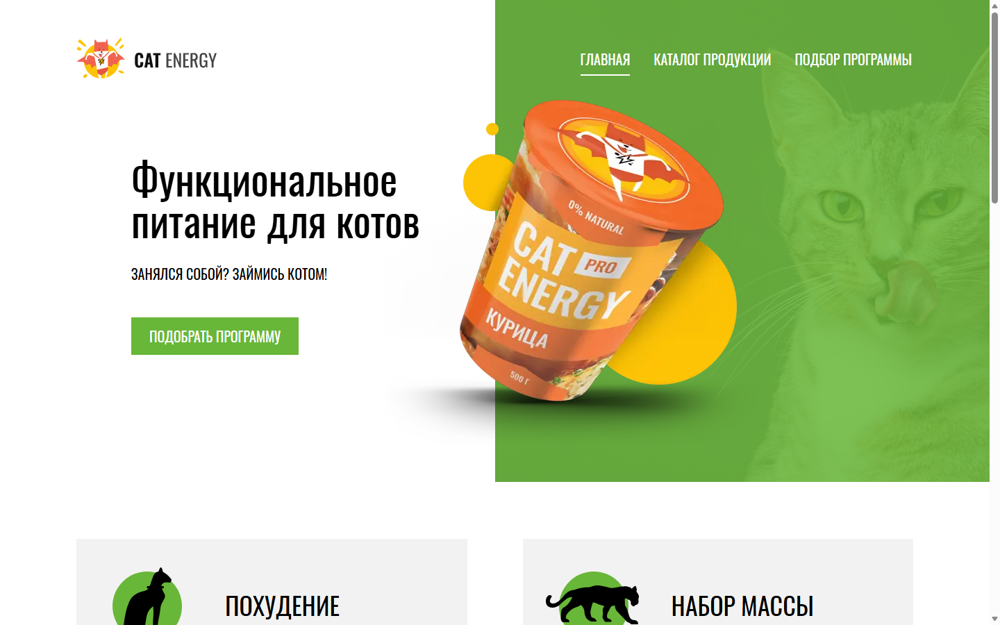

# Cat Energy — responsive website

**[Live demo →](https://reatixx.github.io/Cat-energy/)**



Responsive website of a cat food brand: home page, product catalog and a selection form. Personal project of the HTML Academy course *Adaptive layout*.

## What was done
- Three layouts: mobile, tablet and desktop (mobile first)
- BEM naming, SCSS
- Responsive images with `picture` and WebP, retina versions
- Form with built-in HTML validation
- Gulp build: SCSS compilation, autoprefixer, HTML/CSS/JS minification, image optimisation and WebP, SVG sprite, dev server with live reload

## Stack
HTML5 · SCSS · BEM · Gulp · PostCSS (Autoprefixer)

## Run locally
```bash
npm install
npm start          # dev server
npm run build      # production build
```
